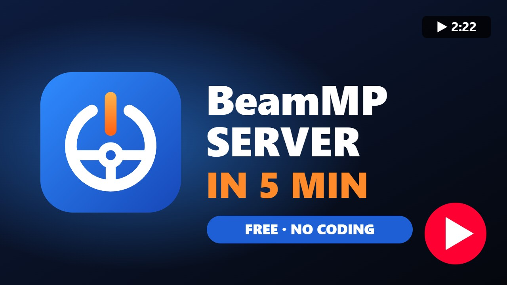
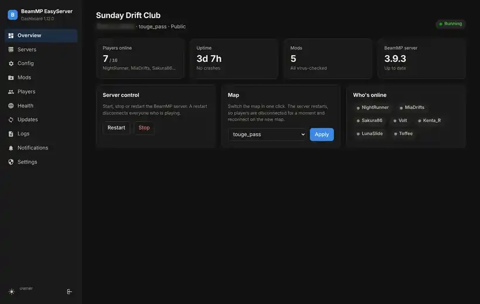

# BeamMP EasyServer

[](https://github.com/Csabika-dev/beammp-easyserver/actions/workflows/tests.yml)
[](https://github.com/Csabika-dev/beammp-easyserver/releases/latest)

**🌐 Website:** [csabika-dev.github.io/beammp-easyserver](https://csabika-dev.github.io/beammp-easyserver/) · **Found a bug?** [Open an issue](https://github.com/Csabika-dev/beammp-easyserver/issues/new/choose) · **Want to help?** [CONTRIBUTING.md](CONTRIBUTING.md)

[](https://youtu.be/DWD9HcW1OIc)

**▶ [Watch the setup video on YouTube](https://youtu.be/DWD9HcW1OIc)** - from download to a running server in about 2 minutes.

**Host your own BeamNG.drive multiplayer (BeamMP) server in one click, on Windows or Linux - and run it from a web dashboard on your PC or phone.**

No config files and no command line needed. The installer downloads the newest official BeamMP server, asks a few simple questions (name, map, player count), sets everything up and starts it. After that you do everything in the dashboard: mods, maps, players, moderation, Discord, backups, health checks and more.



> Not affiliated with or endorsed by the BeamMP team. This only automates the setup of the official [BeamMP server](https://github.com/BeamMP/BeamMP-Server).

## Quick start

1. **Get a free AuthKey** at [keymaster.beammp.com](https://keymaster.beammp.com) (log in with Discord → **Keys** → **+** → copy it).
2. **Install:**
   - **Windows:** download `BeamMP-EasyServer-Windows.zip` from the [latest release](https://github.com/Csabika-dev/beammp-easyserver/releases/latest), extract it, double-click `Install-BeamMP-Server.bat`.
   - **Linux:** `curl -fsSL https://raw.githubusercontent.com/Csabika-dev/beammp-easyserver/main/linux/install.sh | sudo bash`
3. **Open the dashboard** at `http://localhost:30815` on the server computer (Windows: the **BeamMP Dashboard** shortcut), create your password, and you're running. From other devices at home use `http://<server-ip>:30815`.

Then work through the [guides](#-guides) below - start with [Let friends join over the internet](#let-friends-join-over-the-internet).

## Contents

- [The dashboard at a glance](#️-the-dashboard-at-a-glance)
- [Installing](#installing) - [Windows](#windows) · [Linux](#linux-recommended-for-a-dedicated-server)
- [📖 Guides](#-guides) - step by step for every feature
- [Feature reference](#feature-reference) - cars & chat, moderation, anti-bot, privacy
- [Mod virus check](#️-mod-virus-check) · [Encrypted keys](#-your-keys-are-encrypted) · [Security](#how-its-built-security)
- [Roadmap](#️-roadmap) · [Support](#️-support-the-project)

---

## 🖥️ The dashboard at a glance

| Page | What you can do |
|---|---|
| **Overview** | Status, who's online, uptime, start / stop / restart, switch the map in one click |
| **Servers** | Run several servers on one computer, copy a server, CPU / RAM / download limits per server |
| **Config** | Every server setting in a simple form (or as text) with plain-English checks; who can join, map vote, events, map rotation, templates, **security presets**, **teleport & repair**, announcements, restarts, moderation & anti-bot, and **"What changed?"** with one-click undo |
| **Mods** | Drag & drop mods (each one virus-checked), turn them on/off, **light mode** for map mods, one-click mod updates, **modpacks** |
| **Players** | Players per day, busiest hours, top players, server records, **per-map statistics**, kick / mute / ban, **maintenance mode** |
| **Health** | **Health report** (internet, BeamMP backend, server, port, config, AuthKey, plugin, mods, reachability, disk, memory), **diagnostic reports**, the **"someone can't join?"** doctor and the port checker |
| **Updates** | New BeamMP server and EasyServer versions, one-click server update |
| **Logs** | Live server log with a **log explainer**, plus the **activity log** (who changed what) |
| **Notifications** | Crashes, updates, blocked mods, failed logins, joins, health problems ... sent to Discord, email, phone, Telegram or any webhook if you like |
| **Settings** | Alerts, password, two-step login, **users & roles**, internet access (HTTPS), hide your IP, backups, DuckDNS, Discord bot, phone app, **public status page**, sleep & wake-up |

Dark and light mode, works on phones (Android app, or add it to the iPhone home screen). Before anything changes your network the dashboard shows exactly what will change and asks first. Your router is never changed.

---

## Installing

### Before you start: get your free AuthKey (1 minute)

1. Go to **https://keymaster.beammp.com** and log in with Discord
2. Click **Keys**, then **+**, give it any name
3. Copy the key; the installer will ask for it

### Windows

1. Download **BeamMP-EasyServer-Windows.zip** from the [Releases page](https://github.com/Csabika-dev/beammp-easyserver/releases/latest) and extract it (or use the green **Code** button → **Download ZIP** and open the `windows` folder)
2. Double-click **`Install-BeamMP-Server.bat`**
3. Click **Yes** when Windows asks for permission
4. Fill in the window (paste your AuthKey) and press **Install**

That's it. You get a **Start BeamMP Server** shortcut on your desktop.

It also handles:
- The **web dashboard** (a small portable Python is downloaded for it; it starts when you log in). The first time you open it, you create a password
- A **Drop BeamMP Mods Here** desktop icon: drag mod zips onto it (each one is virus-checked first)
- Your AuthKey and VirusTotal key are stored **encrypted**
- Microsoft Visual C++ Runtime (installed automatically if missing)
- Windows Firewall rules for the server port
- Optional auto-start when you log in

| File | What it does |
|---|---|
| `Install-BeamMP-Server.bat` | Install, or change settings later (run it again) |
| `Add-Mods.bat` | Drag mod .zip files onto it (same as the desktop icon) |
| `Reset-Dashboard-Login.bat` | Forgot the dashboard password or lost your two-step phone |
| `Update-BeamMP-Server.bat` | Download the newest BeamMP server |
| `Uninstall-BeamMP-Server.bat` | Remove everything |

### Linux (recommended for a dedicated server)

Linux runs the server in the background as a service. It starts by itself when the computer boots, and it runs well on old laptops and PCs.

#### Option A: one command

Open a terminal and paste:

```bash
curl -fsSL https://raw.githubusercontent.com/Csabika-dev/beammp-easyserver/main/linux/install.sh | sudo bash
```

#### Option B: download and run

1. Download **BeamMP-EasyServer-Linux.zip** from the [Releases page](https://github.com/Csabika-dev/beammp-easyserver/releases/latest) and extract it
2. Double-click **`install.sh`** and choose **Run in Terminal**
   - Doesn't run? Right-click inside the folder → **Open in Terminal**, then type `bash install.sh` and press Enter
3. Enter your password and answer the questions

#### What the Linux installer does automatically

- Detects your distro and downloads the matching official build
- Installs the needed libraries (Lua 5.3)
- Creates a separate `beammp` user so the server doesn't run as root
- Creates a **systemd service** so the server starts on boot and restarts if it crashes
- Opens the port in the firewall (ufw / firewalld) if one is active
- **Laptop mode:** keeps the server running with the lid closed and stops the machine from going to sleep
- Sets up **easy mod uploading**: a drag & drop web page, a `BeamMP-Mods` folder, and automatic restart when mods change
- **Virus-checks every mod** and **stores your keys encrypted** (see below)
- Installs the **web dashboard** (runs as its own limited user, separate from the game server)
- Installs a simple `beammp` command to manage it

#### Managing the server

```
beammp status      is it running?
beammp logs        live server console (Ctrl+C to leave)
beammp restart     restart (also: start / stop)
beammp config      edit name, map, key... then auto-restart
beammp dashboard   dashboard address and password
beammp reset-login new dashboard password, turns off two-step login (lost phone)
beammp mods        list mods
beammp addmod F    add mod .zip file(s)
beammp map NAME    change the map (e.g. beammp map italy)
beammp scan        virus-check all mods again
beammp key         change your BeamMP AuthKey (stored encrypted)
beammp virustotal  set or remove the VirusTotal key (stored encrypted)
beammp ip          the addresses your friends connect to
beammp update      download the newest BeamMP server
beammp uninstall   remove everything (also undoes laptop mode)
```

#### Supported systems

| Distro | Status |
|---|---|
| Ubuntu 22.04 / 24.04 and newer | ✅ official build |
| Linux Mint 21 / 22, Pop!_OS, Zorin, elementary | ✅ official build |
| Debian 12 / 13, LMDE 6+ | ✅ official build |
| Fedora, Arch, openSUSE | ⚠️ best effort |
| 64-bit x86 and ARM64 (e.g. Raspberry Pi 4/5 with 64-bit OS) | ✅ |

#### Advanced (no questions asked)

```bash
sudo bash install.sh --unattended --key YOUR_KEY --name "My Server" \
  --map west_coast_usa --players 10 --public --laptop-mode yes --mod-page yes
```

Run `bash install.sh --help` for all options.

---

---

## 📖 Guides

Click a guide to open it. Every path like **Config → Who can join** means: open the **Config** page in the sidebar, then the card called **Who can join**.

### Getting started

<details>
<summary><b>First start: the checklist</b></summary>

1. Open the dashboard on the server computer (`http://localhost:30815`) and **create a password** (at least 8 characters; 12 if you'll ever use it from outside your home).
2. **Config → AuthKey**: if you didn't enter it during install, paste it now. Without it the server works on your home network but isn't in the public list.
3. **Config → Basics**: server name, description, map, max players. Press **Save changes**.
4. Pick a **security preset** (Config → Security presets) - see [Choose how open your server is](#choose-how-open-your-server-is).
5. **Overview → Start**. The first time, the dashboard shows the key settings once (name, map, public/private, AuthKey, anti-bot ...) so nothing goes live by accident.
6. **Health** page → **Check again**. Everything should be green; anything else says what to do.
7. Optional but recommended: **Settings → Two-step login** (scan the QR code with Google Authenticator, Microsoft Authenticator, Aegis ...).
</details>

<details>
<summary id="let-friends-join-over-the-internet"><b>Let friends join over the internet</b></summary>

Friends on the **same Wi-Fi** can join right away (BeamMP → Direct connect → the server's home address, port 30814).

For everyone else:
1. Give the server computer a fixed address in your router (often called *DHCP reservation* or *static lease*), so the next step keeps working.
2. **Forward port 30814, TCP and UDP**, to the server computer. Search for "*your router model* port forwarding". Several servers? Forward each server's port (shown on the Servers page).
3. Open **Health** → **Full check**. "Reachable from the internet" should be green.
4. If the server is public (Config → Private off) it shows up in the BeamMP server list within a minute or two. Private servers: friends use **Direct connect** with your public address (Health page shows it).
5. Your public address changes from time to time? Set up a free fixed name: **Settings → Fixed address (DuckDNS)**. Friends then connect to `yourname.duckdns.org`.

Worried about your home IP or DDoS? Use **Settings → Hide your IP** and read [PROTECT-YOUR-IP.md](PROTECT-YOUR-IP.md).
</details>

<details>
<summary id="choose-how-open-your-server-is"><b>Choose how open your server is (security presets)</b></summary>

**Config → Security presets**, then **Use** on one of these:

| Preset | For |
|---|---|
| **Most secure** (recommended) | Only invited friends. Hidden from the list, BeamMP accounts only, anti-bot with name check, chat filter, anti-spam, flood protection. Your admins are put on the invite list; add your friends under **Config → Who can join** |
| **Public but safe** | Listed publicly, but no guests, new players type a code once, max 3 per internet connection, chat filter and anti-spam |
| **Friends only** | Hidden and invite-only, otherwise relaxed (no codes, no filter) |
| **Open to everyone** | Public, guests welcome, no extra checks |
| **Weak computer** | Fewer players and cars, abandoned cars removed quickly - for old laptops and slow internet |

The card shows which preset your current settings match. You can change every single setting afterwards, and **Config → What changed?** can undo it.
</details>

<details>
<summary><b>Make the server invite-only</b></summary>

1. **Config → Who can join**: turn on the list and type your friends' **BeamMP usernames**, one per line (not case-sensitive).
2. Press **Save list**. It works right away - no restart.
3. Everyone else (and all guests) gets an "invite-only" message. They appear under **Recently refused** with a **+ allow** button, so letting someone in later is one click.

From Discord (with the bot): `/whitelist add name`, `/whitelist remove name`, `/whitelist list`, `/whitelist on|off`.
</details>

### Running the server

<details>
<summary><b>Add mods (and make joining faster)</b></summary>

1. Open **Mods** and **drag the mod .zip files onto the page** (or click it to pick files). Each one is virus-checked first; blocked files never reach the server.
2. The server restarts by itself about 15 seconds later (Windows: press Restart). This disconnects anyone playing, so add mods when it's quiet.
3. A map mod shows a **map:** badge - click **Use map** to play it.

**Make joining faster:**
- The card at the top shows how much players download before they can join.
- Turn on **Light mode**: only the map mod for the map being played is sent. The other map mods wait (badge *waiting - light mode*) and come back by themselves when you switch to their map - from Config, a map vote, rotation or an event. Mods that aren't maps are always sent.
- Turn on **Show the download size in the server description** so players see it in the server list.

**Share or move mods:** **Mods → Modpack → Download modpack** gives you one .zip of all enabled mods with checksums. On another EasyServer: **Import a modpack…** (virus-checked again). Players on slow internet can copy the files from the modpack's `mods` folder into `Documents\BeamNG.drive\mods\multiplayer` before joining.

**Updates:** mods from the BeamNG repository are checked daily. An **Update** button appears when there's a new version.

Other ways: Windows - drag zips onto **Drop BeamMP Mods Here** on the desktop. Linux - drop them into the `BeamMP-Mods` folder, or `beammp addmod ~/Downloads/*.zip`.
</details>

<details>
<summary><b>Change the map, map vote, rotation and events</b></summary>

- **Switch now:** **Overview → Map**, pick one, confirm. The server restarts on the new map.
- **Let players vote:** **Config → Map vote**: tick the maps players may choose. In the game chat they type `/vote`, then `/vote 2` or `/vote utah`. More than half of the players online = the map changes about 30 seconds later (at most once every 5 minutes).
- **Rotate automatically:** **Config → Map rotation**: tick at least two maps in order, choose how often (1-24 hours) and the countdown. Optionally only change when nobody is online.
- **Weekly events:** **Config → Events → Add event**: name (e.g. "Friday drift night"), days, start time, how long, the map and any mods to turn on. The event is announced in Discord and the game chat, the server switches over at the start time and switches back afterwards. **End now** stops it early.
- **Advertise events:** **Settings → Telegram, Slack & other apps → Advertise events automatically** posts new events to Discord / Telegram / your webhook, again the day before, and reminds players in the game every 30 minutes in the last 3 hours.

Built-in maps: `gridmap_v2`, `west_coast_usa`, `east_coast_usa`, `utah`, `italy`, `jungle_rock_island`, `industrial`, `small_island`, `automation_test_track`, `hirochi_raceway`, `johnson_valley`, `derby`, `driver_training`. Without the dashboard: Linux `beammp map italy`, or edit `ServerConfig.toml` → `Map = "/levels/italy/info.json"`.
</details>

<details>
<summary><b>Chat messages: welcome, tips and announcements at set times</b></summary>

- **Config → Welcome message & announcements**: a greeting only the new player sees, and messages posted to everyone every 5-120 minutes, in turn (your Discord link, rules, tips). `{name}` = the player's name, `{players}` = how many are online.
- **Config → Announcements at set times**: **+ Add**, pick a time and days (e.g. 20:30 on Fri and Sat), write up to 3 lines, tick **Discord** to post it there too, **Save**. Only sent to the game when someone is online.
- **Config → Quick setup: server templates** fills all of this in for a Drift, Racing, Roleplay or Chill server in one click.
</details>

<details>
<summary><b>Teleport and repair commands (/tp, /repair)</b></summary>

1. **Config → In-game tools: teleport & repair**.
2. Turn on **/tp name** and choose the wait between teleports.
3. Choose how **repairing** works:
   - **Normal** - reset keys work as usual, `/repair` too.
   - **Realism** - reset, recover and teleport keys are off for everyone; `/repair` works every few minutes (you choose how many).
   - **Hardcore** - no resets and no repairs.
4. **Save.** EasyServer adds a tiny helper mod (2 KB, shown as *EasyServer tools* on the Mods page) and the server restarts once. Players download it automatically.

In the game:
- `/tp dani` asks Dani; Dani types `/tpaccept` (or `/tpdeny`) within 60 seconds, and you're placed behind their car. Part of a name is enough.
- `/repair` (or `/fix`) repairs your car in place.
- `/help` lists the commands that are on.

**Command suggestions:** when a player types `/` in the chat, the commands of your server appear above the chat box - **Tab** completes, **↑ ↓** choose. Typos get a "did you mean ...?" hint. On by default; switch it off under **Config → In-game tools** (it uses the same tiny helper mod).

The helper only moves or repairs the player's own car, and only when the server says so. Turning every tool off removes it again.
</details>

<details>
<summary><b>Moderate players: kick, mute, ban and in-game admins</b></summary>

- **Players → Online now & moderation**: **Mute 10 min**, **Kick** or **Ban…** (1 hour to forever, with a reason the player sees). Unban under **Banned players**. Send a message to everyone in the game chat.
- **In-game admins:** **Config → Moderation & anti-bot → Admins**: their BeamMP names. They can then type `/kick name`, `/ban name 1d reason`, `/mute name 10`, `/unmute name`, `/unban name` in the game chat. Their bans are saved in the dashboard.
- **Chat filter, anti-spam and anti-bot** are on the same card - see the [feature reference](#moderation--anti-bot-config-and-players-pages).
- Every ban, kick and mute (from the dashboard, Discord or the game) is in **Logs → Activity log**.
</details>

<details>
<summary><b>Maintenance mode (close the server while you work on it)</b></summary>

1. **Players → Maintenance mode**.
2. Write the message players see (e.g. "Updating mods - back at 18:00").
3. Optionally list players who may still join (testers). Admins can always join.
4. Leave **Disconnect the other players** on to warn people online and disconnect them after 10 seconds.
5. **Start maintenance.** Works right away, no restart. Discord's status message and the public status page show "Maintenance".
6. Done? **End maintenance** - everyone can join again and the game chat is told.

Moderators can do this too.
</details>

<details>
<summary><b>Scheduled restarts and automatic updates</b></summary>

**Config → Restarts & updates**: restart once a day at a set time or every 1-12 hours, with a countdown in the game chat - or only when nobody is online. Tick **install BeamMP updates** to update at that restart. EasyServer updates itself from the **Updates** page.
</details>

### Your team

<details>
<summary><b>Give friends their own login (admins, moderators, viewers)</b></summary>

**Settings → Users & roles** (only you, the owner, see this):
1. Type a name, pick a role, set a password (at least 10 characters) → **Add**. Give them the name, the password and the dashboard address.
2. Roles:

| Role | Can |
|---|---|
| **Viewer** | Look at everything, change nothing |
| **Moderator** | Kick, mute, ban, unban, who can join, restart the server, maintenance mode, chat messages |
| **Admin** | Everything except users, passwords, two-step login, internet access and the status page |
| **Owner** (you) | Everything |

3. Change a role, reset a password, disable or delete someone at any time on the same card.

Extra accounts can only log in from your home network. **Logs → Activity log** shows who did what, when and from where - including Discord commands and in-game admin actions.
</details>

<details>
<summary><b>Discord: alerts, status message, bot and chat bridge</b></summary>

**Alerts and the live status message (webhook - 1 minute):**
1. In Discord: your channel → **Edit channel → Integrations → Webhooks → New webhook → Copy webhook URL**.
2. Dashboard: **Settings → Discord** → paste it, turn on **Send to Discord**, **Send test**, then **Save notification settings**.
3. Choose what you're told about under **Notify me about**.
4. **Settings → Discord bot → Live status message** keeps one message in the channel up to date (servers, players, CPU, next events).

**Slash commands (bot - 5 minutes):**
1. Open [discord.com/developers/applications](https://discord.com/developers/applications) → **New Application** → name it.
2. **Installation** → set **Install Link** to **None** and save (otherwise Discord won't let you make the bot private).
3. **Bot** → turn **Public Bot** off. For the chat bridge also turn on **Message Content Intent**. Then **Reset Token** → **Copy**.
4. Dashboard: **Settings → Discord bot** → paste the token, turn the bot on, **Save**. When it says **Online**, click **Add the bot to your Discord**, pick your Discord server, and choose it in **Discord server the bot answers in**.
5. Type `/status` in Discord. New commands can take a minute - restart Discord if they don't show up.

Commands: `/status` and `/events` and `/top` (everyone), `/start`, `/stop`, `/restart`, `/sleep` and `/whitelist` (people with **Manage Server**, or the Discord users you allow). **Chat bridge**: the game chat appears in the channel and messages from the channel appear in the game.

**Join alerts:** **Config → Join alerts** posts when chosen players join ("Dani just joined - 3/8 online") and can ping a role.
</details>

<details>
<summary><b>Alerts on your phone, Telegram, Slack, email and more</b></summary>

All alert channels use the same **Notify me about** switches (Settings). Security alerts always go everywhere you set up.

- **Phone (ntfy):** install the free **ntfy** app (Android / iPhone), then **Settings → Phone app** → scan the subscribe QR code. Stored privately and encrypted.
- **Telegram:** in Telegram open **@BotFather** → `/newbot` → copy the token. **Settings → Telegram, Slack & other apps** → paste it → **Save**. Send your new bot a message (or add it to a group) → **Find my chat** → turn on **Send alerts to Telegram** → **Send test**.
- **Slack, Teams, Mattermost, Rocket.Chat, Google Chat, Home Assistant, n8n, Zapier ...:** create an *incoming webhook* in that app, paste its address under **Any app with a webhook**, turn it on → **Send test**.
- **Email:** **Settings → Email** - your provider's SMTP server. Gmail / Outlook need an *app password* from your account's security settings.
- **Discord:** see the Discord guide above.
</details>

<details>
<summary><b>Phone app</b></summary>

- **Android:** download `BeamMP-EasyServer.apk` from the [latest release](https://github.com/Csabika-dev/beammp-easyserver/releases/latest), install it, then scan the QR code under **Settings → Phone app**. The app remembers your dashboard's certificate, so it only ever talks to your server. It also has a **Wake up** button when the server computer sleeps.
- **Stay logged in:** turn on **Stay logged in on this device** on the login page (on by default in the Android app). Your phone or PC then logs in by itself for 30 days after the last visit. **Settings → Remembered devices** lists them; forget one you lost there. Logging out or changing the password forgets them too.
- **iPhone:** open the dashboard in Safari → Share → **Add to Home Screen**.
</details>

<details>
<summary><b>Public status page (for your players)</b></summary>

1. **Settings → Public status page** → turn it on.
2. Choose whether to show player names and the mod list (with the download size), optionally a title → **Save**.
3. Share `http://<your-address>:30815/status`. It shows each server's state (online, offline, maintenance, sleeping), players, map, mods, the next event and 30-day uptime. No login, no addresses, no buttons.
4. For a website or bot: `/status.json`.

At home it works right away. Players outside your network can only open it when **internet access to the dashboard** is on (see below) - otherwise share Discord's live status message instead.
</details>

### When something goes wrong

<details>
<summary><b>Someone can't join</b></summary>

1. **Health → Someone can't join?** → type their BeamMP name → **Check**. It reads what happened to their last join attempt (banned, not on the invite list, maintenance, guest blocked, anti-bot, too many from one connection, server full ...) and tells you the fix.
2. Nobody can join? **Health → Check again** (or **Full check** for the outside view). Red items say what to do - usually the port isn't forwarded, the AuthKey is missing, or the server isn't running.
3. **Logs → Explain the whole log** lists every error and warning in plain English. Click any red or yellow line to explain just that line.
4. Still stuck? **Health → Download diagnostic report** and share it when asking for help (BeamMP Discord, or an issue here). Keys, passwords and addresses are removed from it.
</details>

<details>
<summary><b>Undo a config change ("What changed?")</b></summary>

**Config → What changed?** keeps the last 40 versions of the config with who changed it and why (a save, a preset, a template, a map switch ...).
- **Show change / Compare with now** lists exactly which settings changed (before → after); **Show the exact lines** shows the raw text.
- **Restore** goes back to that version (your AuthKey is kept). The current version stays in the list, so you can undo the undo.
- **Compare with another server** shows how two of your servers differ.
</details>

<details>
<summary><b>The server keeps crashing or lagging</b></summary>

- **Health** shows memory and disk. **Settings → Computer load** has 24-hour graphs of processor, memory, upload and players.
- Low-resource warnings come with a suggested player limit. Try the **Weak computer** preset, fewer Max cars, or light mode for map mods.
- **Logs → Explain the whole log** - crashes, out-of-memory and broken mods are recognised.
- Running several servers? **Servers → Limits…** caps CPU, RAM and mod download speed per server.
- EasyServer restarts a crashed server automatically and tells you (if crash notifications are on).
</details>

### More

<details>
<summary><b>Run several servers / copy a server</b></summary>

1. **Servers → Add a server**.
2. **Start from**: *a fresh server*, or *a copy of* an existing one - the copy gets its config, who can join, moderation, bans, chat messages, events and restart times (mods aren't copied - use a modpack).
3. Name, a **free port** (each server needs its own, and its own port forward for internet play), optionally its own AuthKey (one key per public server).
4. **Create server.** Pick which server the other pages manage with the **Server** menu at the top of the sidebar.

Each server runs on its own - one crashing doesn't affect the others - and one BeamMP update updates them all. **Limits…** caps CPU, RAM and mod download speed per server.
</details>

<details>
<summary><b>Manage the server from outside your home</b></summary>

**Settings → Access from the internet** is only allowed once:
1. **HTTPS** is on (Settings). The browser warns you the first time - compare the fingerprint shown in Settings, then continue.
2. **Two-step login** is on (scan the QR code with an authenticator app).
3. Your password has at least 12 characters.

Then forward port **30815 (TCP)** on your router. Wrong passwords lock the visitor out for 15 minutes and notify you. Users other than the owner still only work from home.

Forgot the password or lost your phone? Linux: `sudo beammp reset-login`. Windows: double-click `Reset-Dashboard-Login.bat`, then open the dashboard on the server computer.
</details>

<details>
<summary><b>Don't run the computer 24/7 (sleep and Wake-on-LAN)</b></summary>

1. **Settings → Sleep & wake-up → Auto-sleep**: the computer sleeps when nobody has played for a while (5 minutes to 24 hours), optionally only between certain hours. It never sleeps while someone is online, an event runs or starts within 30 minutes, or the dashboard is being used. **Sleep now** and Discord `/sleep` work too.
2. **Wake up by itself** 10 minutes before every event, and optionally every day at a set time - no extra device needed.
3. **Wake-on-LAN** (wake it on demand): connect the computer with a **network cable** (Wi-Fi can't wake it; laptops must stay plugged in) → **Turn on** next to the cable adapter. The **compatibility score** lists exactly what still has to change (e.g. a BIOS setting).
4. **Waking it from anywhere:** the **router guide** has steps for FRITZ!Box, ASUS, TP-Link, Ubiquiti, MikroTik, OpenWrt, Netgear and others. Or use the **wake helper** on a Raspberry Pi or any always-on device at home: it answers `/start` in Discord and the **Wake up** button in the phone app while the server sleeps, without port forwarding.
   - Linux / Raspberry Pi: `curl -fsSLO https://raw.githubusercontent.com/Csabika-dev/beammp-easyserver/main/wake/install-wake-helper.sh && sudo bash install-wake-helper.sh`
   - Windows: `BeamMP-EasyServer-WakeHelper.zip` from the latest release → `Install-Wake-Helper.bat`
   - Pair it with the code from **Settings → Sleep & wake-up → Wake helper**, then **Test the helper**.
</details>

<details>
<summary><b>Backups and moving to a new computer</b></summary>

- **Nightly backups** (on by default, Settings → Automatic backups): every server's settings, invite list, bans, moderation, messages and rotation at 03:30, optionally with mods. The last 7 are kept - download one any time.
- **Move or restore:** **Settings → Backup / move to another computer → Export settings** (or **+ mods**). On the new EasyServer: **Import…** the file. Mods are virus-checked again; keys and passwords are never exported, so paste the AuthKey again.
</details>

---

## Feature reference

### Cars & chat (Config page)

All of this runs in the small EasyServerStats plugin on the server, so players don't need to install anything. Changes work right away, without a restart.

- **Scheduled car cleanup (on by default):** removes every car once a day at 04:00, or every 1, 2, 3, 4, 6, 8 or 12 hours if your server is busy. Players get a countdown in the chat first (30 minutes by default, then 15, 10, 5, 2, 1 minute, 30 seconds and 10…1), and can spawn a fresh car right after.
- **Abandoned cars (off by default):** a car that hasn't moved for 5 minutes (adjustable) is removed; its owner gets a warning 1 minute before. Cars of players who leave are removed by BeamMP itself.
- **Chat commands (off by default):**
  - `/countdown 5` - a "3… 2… 1… GO!" in the chat for drag races and touge runs
  - `/tag drift` - shows `[DRIFT]` in front of your chat messages (you choose which tags exist); `/tag off` removes it
  - `/top` - server records: top speed, distance driven and the longest drive without a reset; `/top me` for your own
  - `/help` lists the commands that are on

### Moderation & anti-bot (Config and Players pages)

- **Kick, mute and ban** from the Players page: bans can be for an hour, a day, 7 or 30 days, or forever, with a reason players see. Send a message to everyone in the game chat.
- **Admins** you name can use `/kick`, `/ban name 1d reason`, `/mute name 10`, `/unmute` and `/unban` in the game chat. Their bans are saved in the dashboard too.
- **Chat filter** (off by default): hides blocked words, @everyone and Discord invite links, and refuses player names with links. Repeat offenders are muted for 5 minutes.
- **Anti-spam** (off by default): too many messages in 10 seconds = a 2 minute mute.
- **Anti-bot** (off by default) stops bots from filling your server. Cloudflare can only protect websites, not a game server, so this works inside the game:
  - **Join check:** new players type a code shown in chat (`/verify 4821`) within 2 minutes or are kicked; each player only does this once
  - **Block guests** (players without a BeamMP account)
  - **Max players from one internet connection** (your own network is never limited)
  - **Max new players per minute:** above it, new joins pause for 2 minutes and you get a security alert


### Privacy

- **IP addresses are blurred** in the dashboard until you click them, so screenshots and screen-sharing don't leak your address.
- **Address change warning:** if the server's home address or your public IP changes, you get a notification with the new address and how to stop it happening.
- Player statistics, the activity log and diagnostic reports stay on your computer.

---

## 🛡️ Mod virus check

Every mod is checked **before** players can download it, whichever way you add it (web page, folder, drag & drop or command). Mods that fail are refused, or moved to `Resources/Quarantine` with a note explaining why.

| Check | Windows | Linux | What it catches |
|---|---|---|---|
| **Built-in checks** (always on, offline) | ✅ | ✅ | Hidden programs (`.exe`, `.dll`, `.bat`, `.ps1`...), files that are secretly programs (e.g. a "texture" that is really an `.exe`), disguised names like `photo.jpg.scr`, password-protected files, "zip bombs", and files trying to escape the mods folder |
| **Lua script check** | ✅ | ✅ | Warns about mod scripts that can run commands, load native code, open network connections or hide encoded code |
| **Antivirus** | Microsoft Defender (built into Windows) | ClamAV, if installed (`sudo apt install clamav`) | Known viruses |
| **VirusTotal** (optional, free key) | ✅ | ✅ | Checks the mod against 70+ antivirus engines. Known files are checked instantly by fingerprint; new files up to 200 MB are uploaded for a scan |

**Results:** ✅ safe → added · ⚠️ unusual but not dangerous (shown with the reason; for example a script that can run commands, which some legit mods do) · ⛔ blocked.

To turn on VirusTotal, make a free account at [virustotal.com](https://www.virustotal.com/gui/join-us), click your name → **API key**, and paste it into the installer (Windows: the *VirusTotal key* field; Linux: `sudo beammp virustotal`). The free key allows 4 checks per minute and 500 per day, which is plenty for mods.

> No checker is perfect. These checks stop the common tricks and known malware, but still only use mods from places you trust.

## 🔐 Your keys are encrypted

Your **BeamMP AuthKey**, your **VirusTotal key**, your **Discord bot token**, your **DuckDNS token**, your **ntfy topics** and the **mod page password** are never stored in plain text, and never in `ServerConfig.toml`.

- **Windows:** encrypted with Windows' own DPAPI, tied to your Windows account. The file is useless on any other PC or account.
- **Linux:** AES-256 encrypted (`/var/lib/beammp-easyserver/secrets.enc`). The unlock key is a separate root-only file in `/etc/beammp-easyserver`.
- When the server starts, the key is decrypted **in memory only**. On Linux the server gets its config from RAM (`/run`). On Windows it gets a temporary copy in your private AppData folder, and the key is wiped from that copy a few seconds after start-up.
- The server and the mod page run as a separate, unprivileged `beammp` user on Linux, which can't read the keys.

So you can share or back up your server folder and `ServerConfig.toml` without leaking your keys. Change them with `sudo beammp key` / `sudo beammp virustotal` (Linux) or by running the installer again (Windows).

## 🗺️ Roadmap

Ideas for future versions (not built yet):

- **Live map** on the status page with car positions (if the BeamMP server makes them available)
- **More game-side rules**: blocking heavy props and articulated trailers, using the same helper mod as `/tp` and `/repair`
- **Plugin ecosystem**: let developers add their own pages and tools to the dashboard
- Mod download statistics

Suggestions are welcome; open an issue.

## How it's built (security)

- Linux: the game server runs as `beammp` and the dashboard as `beammp-dash`. Each can only touch its own files. The few admin jobs (start/stop, updates, saving encrypted keys, firewall) go through a tiny root helper that only accepts a fixed list of actions.
- Keys are encrypted at rest (AES-256 on Linux, DPAPI on Windows) and only decrypted in memory.
- The dashboard uses only Python's standard library: no third-party packages to keep updated.
- Root (and the installer) never opens files inside the server folder by name: they are read and written as the `beammp` user, so a hacked game server or a bad Lua plugin can't use links to reach system files.
- Dashboard login: wrong passwords lock an address for 15 minutes (IPv6 counts per /64), plus a limit for the whole network and for the internet. With two-step login on, a failed login never tells whether the password part was right.
- Remembered devices ("Stay logged in"): only a SHA-256 fingerprint of each device token is stored, in a signed file; a token stops working 30 days after its last use (90 days at most), on logout, on a password change and when its account is deleted. Extra accounts' devices only work from the home network.
- The dashboard only answers when it is opened by its IP address or a local name (`mypc`, `mypc.local`, `*.lan`, `*.fritz.box` ...), which blocks "DNS rebinding" tricks from other websites. The first password can only be set from the server computer itself via `http://localhost:30815`.
- Imports are checked like normal uploads: zip bombs are skipped, settings are validated, and an import can never send your saved email password to a different mail server. Changing the mail server in Settings also needs the password typed again.
- Windows: the install folder is locked down so only you, administrators and SYSTEM can change it (folders in `C:\` can otherwise be changed by every user of the PC).
- **Security alerts (on by default):** password guessing, websites probing the dashboard ("DNS rebinding"), mods that fail the virus check, tampered server files (planted links), zip bombs in imports and connection floods raise an alert. It goes to every channel you set up (dashboard banner, Discord, email - even if their normal switch is off, plus pop-ups on devices where you allowed them) and repeats every 15 minutes until you click **Got it - stop alerts** (or the link / pop-up in the message). Both can be turned off under Settings -> Security alerts.
- On your home network the dashboard uses plain HTTP unless you turn on HTTPS in Settings - turn it on if other people share your Wi-Fi.

**Worried about DDoS / your home IP?** Turn on **Settings → Hide your IP** and see [PROTECT-YOUR-IP.md](PROTECT-YOUR-IP.md).

**Found a security bug?** Please don't open a public issue - report it privately with the **Report a vulnerability** button on the [Security tab](https://github.com/Csabika-dev/beammp-easyserver/security) or email **beammp.easyserver.security@gmail.com**. See [SECURITY.md](SECURITY.md).

## ❤️ Support the project

BeamMP EasyServer is free. If it saved you some time, you can buy me a coffee using the **Sponsor** button at the top of this page. Thank you!

## License

MIT. See [LICENSE](LICENSE). The BeamMP server itself is licensed separately by the BeamMP team.
